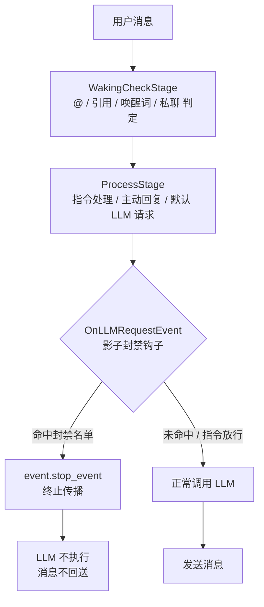

<!-- markdownlint-disable MD028 -->
<!-- markdownlint-disable MD033 -->
<!-- markdownlint-disable MD041 -->


<p align="center">
  
  
  
</p>

<p align="center">
  
  
  
</p>

<p align="center">
  
  
  
</p>

[](https://github.com/Pancakes-Labs/astrbot_plugin_shadow_ban)

---

一个为 [AstrBot](https://github.com/AstrBotDevs/AstrBot) 设计的影子封禁（Shadow Ban）插件。把指定用户从机器人的大模型（LLM）响应链路中**静默移除**：他照常发言，机器人照常在线，只是——永远不理他。

## 📑 快速导航

- [✨ 功能特性](#-功能特性)
- [📊 输出示例](#-输出示例)
- [🚀 安装与使用](#-安装与使用)
- [📋 指令说明](#-指令说明)
- [⚙️ 配置项详解](#️-配置项详解)
- [🖥️ 插件面板](#️-插件面板)
- [📂 插件目录与结构](#-插件目录与结构)
- [🏗️ 架构说明](#️-架构说明)
- [❓ 常见问题](#-常见问题)
- [🚧 已知限制](#-已知限制)
- [📄 许可证](#-许可证)

---
<!-- 开发者的话 -->
> **开发者的话：**
>
> 大家好，我是 DBJD-CR，这是我为 AstrBot 开发的第五个插件，如果存在做的不好的地方还请理解。
>
> 和我写的其他插件一样，本插件也是"Vibe Coding"的产物。
>
> 所以，**本插件的所有文件内容，全部由 AI 编写完成**，我几乎没有为该插件编写任何一行代码，仅进行了架构设计与修改部分文字描述和负责本文档的润色。所以，或许有必要添加下方的声明：

> [!WARNING]  
> 本插件和文档由 AI 生成，内容仅供参考，请仔细甄别。
>
> 插件目前仍处于开发阶段，无法 100% 保证稳定性与可用性。
>
> 如果觉得这个插件比较实用的话，**就为这个插件点个** 🌟 **Star** 🌟 **吧~** ，这是对我们的最大认可与鼓励！

> [!NOTE]
> 虽然本插件的开发过程中大量使用了 AI 进行辅助，但我保证所有内容都经过了我的严格审查，所有的 AI 生成声明都是形式上的。你可以放心参观本仓库和使用本插件。

> [!TIP]
> 本项目的相关开发数据 (持续更新中)：
>
> 开发时长：累计 2 天（主插件部分）
>
> 累计工时：约 3 小时（主插件部分）
>
> Tokens Used：6,481,500

---

## ✨ 功能特性

### 🛡️ 静默拦截

将被封禁用户的消息从 LLM 响应链路中静默移除：

- 消息**不会**触发任何 LLM 回复；
- 机器人**不会**给出任何提示、报错或“你已被拉黑”的回应；
- 对当事人而言，表现只是“机器人恰好没理我”。

### 🎯 全入口覆盖

本插件在 AstrBot 管线的 `OnLLMRequestEvent` 钩子上做**单点拦截**，以下入口全部覆盖：

| 入口 | 说明 |
| --- | --- |
| 群聊 @提及 | @ 机器人后触发的响应 |
| 引用消息提及 | 回复 / 引用机器人消息后触发的响应 |
| 唤醒词触发 | 命中唤醒前缀后触发的响应 |
| 私聊消息 | 与机器人的一对一对话 |
| 主动回复（概率） | 官方群聊“主动回复”的纯概率触发 |

> 由于所有入口最终都汇聚到同一个 LLM 请求钩子，插件只需在此处终止事件传播（`event.stop_event()`），即可一次性屏蔽全部路径，无需逐个适配。

### 🚫 指令放行

| 场景 | 处理 |
| --- | --- |
| 指令触发的 LLM 调用（如 `/xxx`） | **默认放行**，不影响机器人的功能性回复 |
| 非封禁用户 | 正常响应 |
| 插件总开关关闭 | 完全放行 |

指令放行可通过配置项 `放行指令触发的 LLM 调用` 调整。

### ⚙️ 可视化配置

提供完整的 WebUI 配置界面，覆盖总开关、群聊 / 私聊独立开关、封禁名单与指令放行开关。

### 🖥️ 插件面板

在 WebUI 的插件详情页可打开「影子封禁面板」，实时查看：

- 插件总开关与生效范围（群聊封禁 / 私聊封禁 / 指令放行）；
- 当前封禁名单（含裸 ID 与 `平台:ID`）；
- 累计拦截次数与最近 100 条拦截记录（时间、类型、平台、用户、内容）。

## 📊 输出示例

- 封禁用户发送 `@机器人 你好`：**无任何回复**（静默拦截）
- 封禁用户引用机器人消息：**无任何回复**（静默拦截）
- 封禁用户命中唤醒词：**无任何回复**（静默拦截）
- 封禁用户私聊机器人（且开启私聊封禁）：**无任何回复**（静默拦截）
- 群聊触发“主动回复”概率命中封禁用户：**不触发**（静默拦截）
- 封禁用户执行 `/帮助`：**正常回复**（指令放行）

## 🚀 安装与使用

1. **下载插件**: 通过 AstrBot 的插件市场下载。或从本 GitHub 仓库的 Release 下载 `astrbot_plugin_shadow_ban` 的 `.zip` 文件，在 AstrBot WebUI 中的插件页面右下角的 `➕` 选择 `从文件安装`。
2. **安装依赖**: 本插件无第三方运行时依赖，通常无需额外安装。如果你的环境中确实缺少相关依赖，请安装：

   ```bash
   pip install -r requirements.txt
   ```

3. **重启 AstrBot (可选)**: 如果插件没有正常加载或生效，可以尝试重启你的 AstrBot 程序。
4. **配置插件**: 进入 AstrBot WebUI，找到 `影子封禁` 插件，选择 `插件配置` 选项，填写封禁名单等相关参数。

## 📋 指令说明

本插件**不注册任何指令**，完全通过配置文件驱动，配置保存后即时生效。

---

## ⚙️ 配置项详解

本插件在 AstrBot WebUI 中提供了一套简洁的配置体系，覆盖启停开关、作用范围与封禁名单。
您可以在 AstrBot 管理面板的“插件配置”中直接编辑，无需修改代码。

<details>
<summary>点击查看配置项详解</summary>

### 🧩 1. 启停开关

- **插件总开关 (`enable`)**:
  - 类型：`Boolean`
  - 默认值：`true`
  - 说明：关闭后本插件完全不生效。

- **群聊中启用影子封禁 (`enable_group`)**:
  - 类型：`Boolean`
  - 默认值：`true`
  - 说明：关闭后，群聊中封禁名单不生效。

- **私聊中启用影子封禁 (`enable_private`)**:
  - 类型：`Boolean`
  - 默认值：`false`
  - 说明：开启后，封禁名单同样对私聊消息生效。

```json
{
  "enable": true,          // 插件总开关
  "enable_group": true,    // 群聊中启用
  "enable_private": false  // 私聊中启用
}
```

---

### 📝 2. 封禁名单 (`blocked_users`)

- 类型：`List`
- 默认值：`[]`
- 说明：每行一个条目，支持两种写法。

**裸 ID（推荐）**：

```text
123456
```

直接填写 QQ 号等原始 ID，在**所有平台**生效。

**平台:ID（多平台精细化）**：

```text
aiocqhttp:123456
telegram:987654321
```

仅在指定平台生效。平台名与 AstrBot 适配器名一致，常见值：`aiocqhttp`、`qq_official`、`telegram`、`discord`、`lark`、`slack` 等。

> 当你在多平台运行、且担心不同平台存在相同 ID 时使用此写法。

---

### ✅ 3. 行为控制 (`allow_command_llm`)

- **放行指令触发的 LLM 调用 (`allow_command_llm`)**:
  - 类型：`Boolean`
  - 默认值：`true`
  - 说明：开启后，通过指令（如 `/xxx`）触发的 LLM 请求不会被拦截，避免影响机器人的功能性回复；仅拦截普通聊天所触发的 LLM 响应。

```json
{
  "allow_command_llm": true   // 放行指令触发的 LLM 调用
}
```

</details>

---

## 📂 插件目录与结构

```bash
AstrBot/
└─ data/
   └─ plugins/
      └─ astrbot_plugin_shadow_ban/
         ├─ .astrbot-plugin/                # 插件国际化资源
         │  └─ i18n/                        # 语言文件（zh-CN / en-US）
         ├─ .gitignore                      # Git 忽略规则
         ├─ _conf_schema.json               # AstrBot WebUI 配置界面 schema 定义
         ├─ CHANGELOG.md                    # 插件更新日志
         ├─ CONTRIBUTING.md                 # 本插件的贡献指南
         ├─ LICENSE                         # 许可证文件
         ├─ main.py                         # 插件主入口文件（单点拦截逻辑）
         ├─ metadata.yaml                   # 插件元数据信息
         ├─ pages/                          # 插件 Pages（WebUI 内嵌面板）
         │  └─ dashboard/                   # 影子封禁面板
         ├─ README.md                       # 插件说明文档
         ├─ requirements.txt                # 插件依赖声明（无第三方依赖）
         ├─ run_ruff.bat                    # Ruff 一键格式化与自动修复脚本
         │
         └─ assets/                         # README / 仓库展示资源
```

---

## 🏗️ 架构说明



核心思想：所有会触发 LLM 响应的入口，最终都会汇聚到 `OnLLMRequestEvent`。插件只需在此处做一次判定，即可实现对全部入口的统一拦截。

---

## ❓ 常见问题

### Q1：被封禁的人会发现吗？

不会。插件不发送任何提示消息，当事人只能感知到“机器人没回复”。

### Q2：会影响我用指令调用机器人吗？

不会。指令触发的 LLM 调用默认放行，`放行指令触发的 LLM 调用` 可进一步控制。

### Q3：修改名单要重启吗？

不需要，保存后即时生效。插件在每次判定时都会重新读取名单。

### Q4：支持哪些平台？

所有 AstrBot 支持的平台均可。名单中的裸 ID 在各平台通用，也可用 `平台:ID` 精确指定。

### Q5：为什么私聊默认不封禁？

考虑到私聊通常是主动发起的一对一沟通，误封的体感更明显，因此默认关闭。如有需要可在配置中开启 `私聊中启用影子封禁`。

---

## 🚧 已知限制

- 本插件只拦截 LLM 响应链路，**不拦截指令本身的执行**。若某个插件指令在内部自行调用 LLM，默认会被放行。
- 拦截依赖 AstrBot 的 `OnLLMRequestEvent` 钩子；若未来核心管线调整该钩子的语义，拦截效果可能受影响。

## 💖 友情链接与致谢

- [AstrBot](https://github.com/AstrBotDevs/AstrBot)：在此感谢其开发团队对该项目的付出。

## 📚 推荐阅读

我的其他插件：

- [主动消息 (Proactive_chat)](https://github.com/Pancakes-Labs/astrbot_plugin_proactive_chat) - 它能让你的 Bot 在特定的会话长时间没有新消息后，用一个随机的时间间隔，主动发起一次拥有上下文感知、符合人设且包含动态情绪的对话。
- [灾害预警 (Disaster_Warning)](https://github.com/Pancakes-Labs/astrbot_plugin_disaster_warning) - 它能让你的 Bot 提供实时的地震、海啸、台风、气象预警信息推送服务。
- [视奸面板 (Live_Dashboard)](https://github.com/Pancakes-Labs/astrbot_plugin_live_dashboard) - 它能让你的 Bot 和群友随时随地视奸你。
- [代码统计 (Count_Loc)](https://github.com/Pancakes-Labs/astrbot_plugin_count_loc) - 它能让你的 Bot 对任意公开的 GitHub 或 GitLab 仓库的代码行数、文件数量、注释行数、物理总行数等指标进行快捷获取和分析。

## 🤝 贡献

欢迎提交 [Issue](https://github.com/Pancakes-Labs/astrbot_plugin_shadow_ban/issues) 和 [Pull Request](https://github.com/Pancakes-Labs/astrbot_plugin_shadow_ban/pulls) 来改进这个插件！

- 对于新功能的添加，请先通过 Issue 等方式讨论。
- 对于 PR (拉取请求)，请确保你已阅读并同意遵守本项目的 [贡献指南](https://github.com/Pancakes-Labs/astrbot_plugin_shadow_ban/blob/main/CONTRIBUTING.md)。

## 📞 联系我们

如果你对这个插件有任何疑问、建议或 bug 反馈，欢迎加入我的 QQ 交流群。

- **QQ 群**: 1033089808
- **群二维码**:
  
  

## 📄 许可证

GNU Affero General Public License v3.0 - 详见 [LICENSE](LICENSE) 文件。

本插件采用 AGPL v3.0 许可证，这意味着：

- 您可以自由使用、修改和分发本插件。
- 如果您在网络服务中使用本插件，必须公开源代码。
- 任何修改都必须使用相同的许可证。

## 📊 仓库状态


## ⭐️ 星星

<a href="https://www.star-history.com/?repos=pancakes-labs%2Fastrbot_plugin_shadow_ban&type=date&legend=top-left">
 <picture>
   <source media="(prefers-color-scheme: dark)" srcset="https://api.star-history.com/chart?repos=pancakes-labs/astrbot_plugin_shadow_ban&type=date&theme=dark&legend=top-left" />
   <source media="(prefers-color-scheme: light)" srcset="https://api.star-history.com/chart?repos=pancakes-labs/astrbot_plugin_shadow_ban&type=date&legend=top-left" />
   
 </picture>
</a>

---

Made with ❤️ by DBJD-CR
